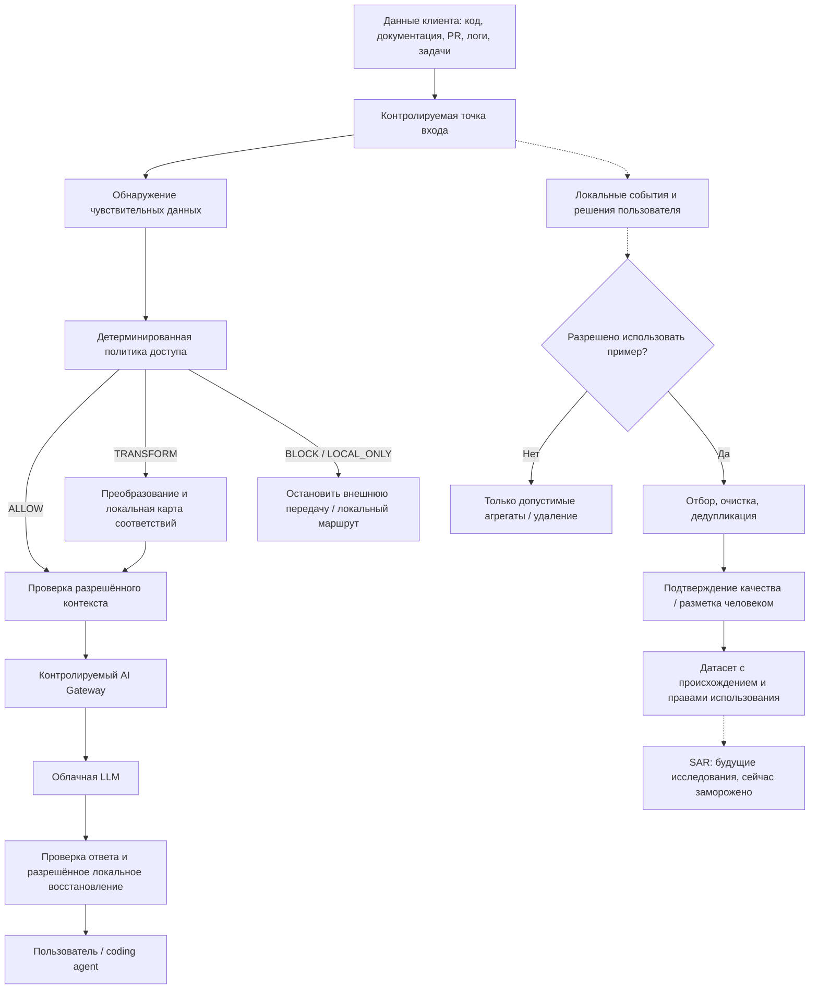

# SkillLayer Secure Context and Data Pipeline

**Обновлённый план · v0.2 · 24 ноября 2026**

**Статус:** гипотеза Secure Context уточняется на встрече с True Engineering 26 ноября.

**Решение по архитектуре:** гибридный подход — готовые инструменты для стандартного обнаружения и маршрутизации; собственный код SkillLayer для политики, управления контекстом и проверяемого применения решений.

**Цель документа:** ограничить первый спринт работающим проверяемым сценарием и не строить параллельно платформу данных.

## 1. Идея

**SkillLayer Secure Context** — локальный или корпоративный слой управления контекстом, который передаётся AI-инструментам. Он использует готовые средства обнаружения и шлюз, если такой уже принят в компании, а собственную логику SkillLayer — для решений о передаче и проверки результата. Это основной сценарий первого PoC.

**Dataset Pipeline** остаётся отдельным будущим направлением: отбор разрешённых данных, фиксация происхождения и экспорт. Его архитектурные границы сохраняются, но реализация откладывается до проверки Secure Context и отдельного подтверждения потребности.

Общая задача — **сохранять полезность информации при соблюдении правил её использования**. Сама по себе замена имён, email и токенов не обеспечивает конфиденциальность исходного кода: коммерческая логика может оставаться узнаваемой.

### Продуктовая гипотеза

Командам, использующим облачные AI-инструменты, нужен единый управляемый процесс подготовки корпоративного контекста. Он должен уменьшать риск нежелательной передачи данных и сохранять качество работы модели. Часть проверенных и отдельно разрешённых рабочих примеров может впоследствии пополнять корпоративные датасеты.

**Что нужно доказать:** в каком конкретном сценарии этот процесс полезнее существующих решений, как влияет на качество ответа LLM и кто в организации готов внедрять его и оплачивать.

## 2. Границы версии

| Контур | В первом PoC (2 недели) | После подтверждения пилота | Позже |
|---|---|---|---|
| Интеграция | Один маршрут через существующий gateway клиента либо выбранный готовый прокси | Один рабочий клиент / один тип AI-инструмента | Несколько IDE, агентов и провайдеров |
| Готовые средства | Проверить Presidio для PII и Gitleaks для секретов; сохранить возможность использовать инструменты клиента | Настраиваемый набор проверенных детекторов | Глубокая классификация бизнес-логики |
| Логика SkillLayer | Минимальная политика `ALLOW / TRANSFORM / LOCAL_ONLY / BLOCK`, повторная проверка запроса и аудит решения без сырых данных | Управляемые правила по проектам и типам данных | Сложные политики по командам и проектам |
| Преобразование | Детерминированное маскирование только тестовых синтетических значений | Проверенные преобразования для согласованных типов данных | Стабильные корпоративные псевдонимы и восстановление |
| Dataset Pipeline | Не реализуется; только сохраняется граница отдельного добровольного потока | Только после отдельного подтверждения спроса, прав и владельца данных | Разметка, lineage, экспорт и исследовательское использование |
| Интерфейс | CLI / JSON-отчёт для демонстрации | Минимальные настройки и отчёт пилота | Веб-панель и управление организациями |

**За пределами первого релиза:** универсальное обезличивание произвольного кода, обучение LLM, собственный инструмент разметки, многоагентная проверка, поддержка всех IDE. **SAR остаётся замороженным** до появления качественных реальных данных и отдельного решения о возобновлении.

## 3. Потоки данных



**Сплошные стрелки:** предполагаемый путь обработки запросов. **Пунктир:** отдельный, добровольный поток данных для анализа и обучения; он не запускается автоматически после обращения к LLM.

### Важная граница контроля

Шлюз может проверять только **запросы, реально проходящие через него**. Если IDE или агент обращается к облаку в обход шлюза, заявлять о полном контроле нельзя. Для строгого корпоративного режима может потребоваться маршрутизация трафика через утверждённую точку выхода и ограничение альтернативных каналов на стороне клиента.

## 4. Гибридная архитектура и границы ответственности

| Компонент | Берём готовым | Собственная ответственность SkillLayer |
|---|---|---|
| Gateway | Существующий gateway клиента — приоритет; готовый прокси только если собственного нет и выбран после встречи. LiteLLM MIT вне `enterprise/`; advisories требуют сверки и pin исправленной версии перед PoC | Подключение одного маршрута и проверка, что PoC контролирует только трафик через эту точку |
| PII detector | Presidio (MIT; текущий upstream — `data-privacy-stack/presidio`, ранее `microsoft/presidio`); дополнительные recognizers — только при необходимости | Интерпретация находок в политике; отсутствие находки не считается доказательством отсутствия PII |
| Secret detector | Gitleaks (MIT; upstream объявил feature-complete и планирует дальнейшие релизы как security fixes) либо уже одобренный клиентом инструмент | Нормализация результата и применение решения политики; секреты не записываются в журналы |
| Политика | Не заменяется внешней библиотекой | Детерминированные `ALLOW / TRANSFORM / LOCAL_ONLY / BLOCK`, приоритет запрета и fail-closed при сбое обязательной проверки |
| Передача контекста | API и возможности выбранного шлюза | Управление тем, какой подготовленный контекст разрешено отправить |
| Преобразование и верификация | Использовать подходящие операции детектора, если они сохраняют структуру | Проверяемая трансформация, повторный скан подготовленного запроса, безопасный журнал причин |
| Анализ кода | В PoC не требуется; Tree-sitter отложен. Semgrep Community Edition rules не использовать в коммерческом сервисе без отдельной проверки их ограничительной лицензии | Не обещать автоматическое обнаружение коммерческой логики |
| Dataset / разметка | Не входит в спринт; Label Studio или другой инструмент можно оценить позднее | Добровольность, provenance и допуск данных — отдельный будущий контур |

**Принцип:** SkillLayer не переписывает Presidio, Gitleaks или LLM gateway. Открытые компоненты дают обнаружение и транспорт; продуктовая логика SkillLayer выбирает действие, контролирует передачу, проверяет преобразованный запрос и связывает решение с Core. Проверка лицензии, версии, известных advisories и режима размещения обязательна перед выбором конкретной зависимости.

**Выбор шлюза не сделан.** Сначала выясняем у True Engineering, какой gateway уже используется и где проходит реальный трафик. LiteLLM — возможный вариант, но не решение по умолчанию; его можно рассматривать после проверки актуального исправленного релиза и требований компании.

## 5. Политики обработки

| Действие | Смысл | Пример |
|---|---|---|
| `ALLOW` | Разрешить передачу без изменения | Публичная документация |
| `TRANSFORM` | Заменить допустимые чувствительные значения | Адрес клиента → `<EMAIL_1>` |
| `LOCAL_ONLY` | Оставить обработку в инфраструктуре клиента | Закрытый модуль с коммерческой логикой |
| `BLOCK` | Запретить внешнюю отправку | Неизвестный секрет или запрещённый тип файла |

**Приоритет политики:** явный запрет выше разрешения; неизвестный тип данных или ошибка обязательной проверки → внешняя передача останавливается. Решение сохраняет код причины, идентификатор применённой политики и список преобразованных сущностей **без записи сырых секретов**.

Для пилота достаточно конфигурации правил в YAML/JSON с фиксированной схемой. Гибкий язык политик и UI-конструктор пока не требуются.

## 6. Secure Context сейчас; Dataset Pipeline позже

### A. Secure Context / Inference

1. Клиентский инструмент передаёт запрос в контролируемую точку входа.
2. Детекторы находят известные категории чувствительных данных; правила проекта задают области с запретом передачи.
3. Policy Engine выбирает `ALLOW`, `TRANSFORM`, `LOCAL_ONLY` или `BLOCK`.
4. Перед отправкой происходит повторная проверка подготовленного запроса; при ошибке обязательной проверки запрос не уходит наружу.
5. Ответ модели проверяется и при необходимости преобразуется локально, с учётом разрешений на восстановление значений.
6. В журнал попадают технические метаданные и решения политики; сырой запрос сохраняется только по отдельному разрешению и с понятным сроком хранения.

**Главный эксперимент:** насколько преобразование данных снижает обнаружимые утечки и как меняет качество решения одной и той же задачи моделью.

### Отложенный контур: Dataset Pipeline / Training Data

Реализация не входит в первый спринт и не запускается автоматически из-за использования Secure Context. До её начала владелец данных должен отдельно подтвердить источник и разрешённые цели использования.

Будущий процесс должен включать:
2. Пример проходит очистку, дедупликацию и контроль возможных чувствительных фрагментов.
3. Сохраняются происхождение, лицензия / разрешение, версия преобразования и связи между задачей, замечанием, исправлением и решением человека.
4. Качество метки подтверждается отдельной процедурой; прохождение тестов **само по себе не делает пример положительной меткой**.
5. Пример экспортируется в версионированный датасет либо отклоняется с причиной.

**Важное разграничение:** локальная агрегированная телеметрия Core 1.0 и обучающие примеры — разные категории данных. По умолчанию код клиента не передаётся в общий датасет SkillLayer. Доступ, цели использования и отзыв разрешения определяются отдельно. В первом спринте не создаём экспорт сырых запросов и обучающих примеров.

### Минимальный формат записи датасета

```json
{
  "example_id": "sample-001",
  "source_type": "review_fix",
  "project_ref": "internal-alias",
  "consent_ref": "permission-record-id",
  "license_status": "verified",
  "processing_version": "0.1",
  "review_status": "pending_human_validation",
  "label": null,
  "artifact_ref": "local://approved-artifacts/sample-001",
  "split_group": "commit-family-001"
}
```

Формат примерный; `local://...` обозначает внутреннюю ссылку, а не реальный протокол доступа. Поля `consent_ref`, `license_status` и `split_group` нужны, чтобы отделять разрешённые примеры и не допускать утечку связанных коммитов между train/test.

## 7. Как оценивать качество

| Метрика | Определение | Как проверяем |
|---|---|---|
| Leakage / miss rate | Доля чувствительных сущностей, прошедших в разрешённый внешний запрос | Размеченные тестовые примеры + ручная проверка |
| False-block rate | Доля разрешённых запросов, которые система блокирует | Негативные примеры, подтверждение экспертом |
| Task success delta | Изменение успешности выполнения задач после преобразования контекста | Одинаковые задачи с исходным и преобразованным контекстом |
| Latency overhead | Дополнительное время на подготовку запроса | Измерения на одном оборудовании и провайдере |
| Coverage of interception | Доля тестовых вызовов, проходящих через шлюз | Интеграционные тесты клиента, проверка обходных каналов |
| Dataset yield | Доля примеров, пригодных к экспорту после разрешений и проверки | Журнал отклонений и человеческая оценка |

Для PoC достаточно **10–20 синтетических, но реалистичных сценариев**; это проверка механики, а не статистическое доказательство безопасности. Для клиентского пилота потребуется отдельный согласованный набор реальных разрешённых кейсов и заранее определённые критерии приёмки.

## 8. Первый спринт: 25 ноября — 8 декабря 2026

### Цель спринта

Показать на одном согласованном маршруте, что SkillLayer может получить тестовый запрос, применить готовые детекторы, принять собственное детерминированное решение, безопасно преобразовать или остановить передачу и показать проверяемый результат. Это PoC механики, а не гарантия полного обнаружения утечек и не релиз для реальных корпоративных данных.

### План по рабочим дням

Каждый день заканчивается проверяемым артефактом и отдельным коммитом. Календарь рассчитан на 10 рабочих дней для одного разработчика; день кастдева зависит от встречи True Engineering.

| День | Дата | Основная работа | Итог дня |
|---:|---|---|---|
| 1 | Ср, 25 ноября | Аудит точек интеграции; сравнить существующий secret scanner с Gitleaks на синтетической матрице; проверить Presidio email/phone detection + masking в изолированном окружении | Воспроизводимый отчёт: Core 9/9, Gitleaks 7/9 синтетических секретных форматов, оба 0/2 на отрицательных контролях; Presidio замаскировал email/US phone; ограничения и версии зафиксированы |
| 2 | Чт, 26 ноября | Кастдев: текущий клиент, маршрут, gateway/DLP, типы данных, владелец и критерии пользы | Решение о сценарии пилота и карта текущих компонентов клиента |
| 3 | Пт, 27 ноября | Сопоставить интервью с архитектурой; выбрать интеграционный маршрут либо доказуемо зафиксировать блокировку; проверить лицензию и версию выбранных компонентов | Архитектурное решение ADR на одну страницу и план интеграции |
| 4 | Пн, 30 ноября | Поднять выбранные детекторы в разрешённой изолированной среде; прогнать синтетические PII/secret/clean fixtures. Если среда недоступна — зафиксировать конкретный блокер и не заменять детекторы самописными | Результаты реальных детекторов либо точный блокер; известные пропуски и ложные срабатывания |
| 5 | Вт, 1 декабря | Определить минимальный контракт findings → policy; реализовать только pure policy path отдельно от Core | Демонстрация детерминированных решений `ALLOW / TRANSFORM / LOCAL_ONLY / BLOCK` |
| 6 | Ср, 2 декабря | Подключить обработку подтверждённых PII-находок и повторный scan после трансформации; исключить значения из журналов. Если Presidio недоступен — не моделировать его вывод как реальное обнаружение | Сквозной локальный `TRANSFORM` либо документированный блокер интеграции |
| 7 | Чт, 3 декабря | Подключить обработку secret-находок, запреты по меткам/пути и fail-closed при недоступности детектора | `BLOCK` и `LOCAL_ONLY` без внешнего вызова; проверяемые причины без сырых значений |
| 8 | Пт, 4 декабря | Подключить один реальный локально доступный маршрут/заглушку выбранного gateway; не использовать клиентские ключи | E2E на синтетике; явно обозначены ограничения перехвата и обхода |
| 9 | Пн, 7 декабря | Прогнать 10–20 сценариев и парные чистые случаи; замерить latency и успех одинаковой задачи до/после трансформации | Таблица detection/miss, false-block, task success delta и latency |
| 10 | Вт, 8 декабря | Разобрать результаты, провести демонстрацию, сопоставить с критерием Pre-Review Loop и решить дальнейший шаг | Отчёт PoC и решение: пилот / изменить сценарий / остановить |

### Критерии завершения спринта

- Один конкретный пользовательский сценарий и один маршрут утверждены после встречи.
- Детерминированно проверены все четыре исхода политики; ошибка обязательной проверки не приводит к внешней отправке.
- Ни один тестовый секрет не попадает в журнал; в отчёте остаются только безопасные метаданные.
- Для каждого сценария сохранены ожидаемое решение, фактический результат, результат задачи и измеренная задержка.
- Граница контроля задокументирована: запросы в обход выбранного маршрута этим PoC не контролируются.
- Dataset Pipeline, UI, Tree-sitter, Semgrep, многошлюзовая маршрутизация и обучение моделей не реализуются.

### Гейт и зависимость от Pre-Review Loop

Ранее зафиксированный приоритет — завершить проверку существующего Pre-Review Loop до добавления новых продуктовых функций. Поэтому этот спринт сначала закрывает интервью и технический прототип на синтетике. Интеграция в продукт или пилот на данных клиента начинается только если проверка Pre-Review Loop завершена и клиент подтвердил конкретную потребность. Если гейт не пройден, результатом спринта остаются исследование маршрута и воспроизводимая локальная демонстрация без встраивания в Core.

## 9. Вопросы к True Engineering

1. **Что защищаем?** PII, секреты, код заказчиков, внутренние документы, коммерческие алгоритмы?
2. **Где проблема возникает сегодня?** Claude Code, Cursor, Codex, чат-интерфейсы, MCP, собственные API?
3. **Какие ограничения уже есть?** Полный запрет внешнего кода, разрешённые провайдеры, корпоративный прокси, сетевые правила?
4. **Что уже пробовали?** DLP, LLM Gateway, Presidio-подобные решения; чего им не хватило?
5. **Какие операции допустимы?** Маскирование, обратимая токенизация, локальная модель, ручное утверждение передачи?
6. **Какой результат сочтут полезным?** Меньше ручной подготовки, меньше заблокированных рабочих задач, снижение риска?
7. **Готовы ли дать обезличенные/синтетические тестовые сценарии и ответственного эксперта?**
8. **Нужна ли компании подготовка датасетов для своих моделей?** Какие источники и права на них есть?

**Результат встречи:** один конкретный пользовательский сценарий, владелец проблемы, существующий gateway/инструмент, критерии пилота и ограничения на использование данных. LiteLLM выбирается только если у клиента нет подходящего шлюза и проверка безопасности/условий использования пройдена.

## 10. Основные риски и решения

| Риск | Практическая мера |
|---|---|
| Агент обходит прокси | Один поддерживаемый канал в PoC; корпоративный контроль egress обсуждаем отдельно |
| Необнаруженные чувствительные данные | Правила запрета по источникам и проектам; fail-closed для неопределённых случаев |
| Псевдонимизация ломает код / задачу | Проверка синтаксиса и одинаковые задания до/после преобразования |
| Сам код раскрывает коммерческую тайну | `LOCAL_ONLY` / `BLOCK` для запрещённой логики; не обещать универсального обезличивания |
| Ложные блокировки тормозят команду | Измерять false-block rate и предоставлять управляемое разрешение по политике |
| Недостаточные права на обучение | Отдельное opt-in, учёт происхождения, контроль разрешений и удаления |
| Нет полезных размеченных примеров | Человеческое подтверждение; SAR не размораживать ради количества данных |
| Разрастание объёма | Один канал, один клиентский сценарий, минимальный экспорт, без UI-платформы |
| Риск открытых компонентов | Проверять лицензию конкретного артефакта, активность сопровождения, security advisories и способ поставки; закреплять версии и не считать `latest` безопасным выбором |

## 11. Решения после кастдева

- **Если подтверждена проблема передачи контекста и Pre-Review Loop закрыт:** продолжить Secure Context на одном согласованном маршруте; сначала интегрировать gateway клиента, затем рассматривать внешний прокси.
- **Если у клиента уже есть gateway и детекторы:** не дублировать их; проверить, нужна ли отдельная ценность SkillLayer в политике, контроле преобразований и аудите.
- **Если главная потребность — подготовка данных:** не переключать текущий спринт; подготовить отдельное решение о Dataset Pipeline с подтверждением прав, владельца данных и процесса разметки.
- **Если подтверждённого сценария нет либо Pre-Review Loop не завершён:** остановить продуктовую интеграцию; сохранить только результаты интервью и локального PoC на синтетике.

---

**Ключевой результат проекта:** проверяемая система, которая помогает компании управлять разрешённым контекстом для AI; Dataset Pipeline остаётся отдельным будущим направлением. **Ключевой результат ближайшего этапа:** один работающий локальный сценарий Secure Context и решение о пилоте на основании измерений, а не количества написанных модулей.
